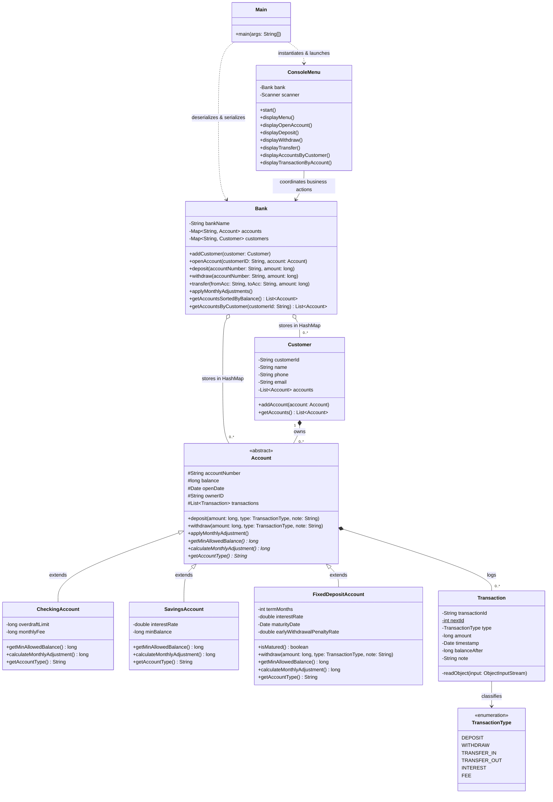
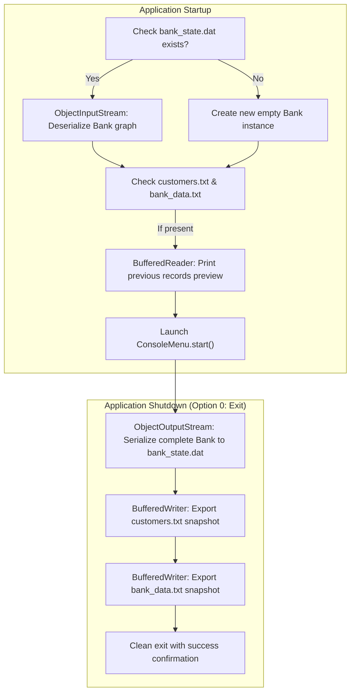

# Bank Account Management System

[](https://www.oracle.com/java/)
[](.github/workflows/java-tests.yml)
[](#project-architecture)
[](#team-and-academic-information)

A robust, console-based banking management application written in pure Java (Java SE 8+). Developed as an academic group project for the **PRO192 (Object-Oriented Programming with Java)** course at **FPT University**, this system demonstrates foundational and advanced Object-Oriented Programming (OOP) paradigms, clean three-tier architecture, resilient Java Collections Framework usage, and dual-mode data persistence (binary object serialization and human-readable audit snapshots).

---

## Table of Contents

- [Project Overview](#project-overview)
- [Key Features](#key-features)
- [Bank Account Types](#bank-account-types)
- [Technologies and Tools](#technologies-and-tools)
- [Project Architecture](#project-architecture)
- [Object-Oriented Programming Concepts](#object-oriented-programming-concepts)
- [Data Persistence – File I/O](#data-persistence--file-io)
- [Getting Started](#getting-started)
- [Example Usage](#example-usage)
- [Project Structure](#project-structure)
- [Team and Academic Information](#team-and-academic-information)
- [License](#license)

---

## Project Overview

The **Bank Account Management System** models the essential business operations of a commercial banking institution within an interactive terminal environment. It enables bank operators to manage customer records, open multi-tier bank accounts, execute financial transactions (deposits, withdrawals, and account-to-account transfers), review complete transaction audit trails, apply periodic monthly interest and maintenance fees, and rank accounts by balance.

### Core Objectives

- **Demonstrate Java OOP Mastery:** Full realization of Encapsulation, Inheritance, Abstraction, Polymorphism (Dynamic Method Dispatch), Method Overriding, and Constructor Overloading.
- **Defensive Business Validation:** Strict precondition verification ("Validate before modify") ensuring transaction integrity and preventing balance corruption or negative balances beyond overdraft allowances.
- **Fail-Safe CLI Navigation:** Menu-driven interface protected by granular exception handling (`NumberFormatException`, `IllegalArgumentException`) to prevent abrupt crashes on invalid user input.
- **Dual Persistence Strategy:** Full application graph persistence using Java Object Serialization alongside human-readable text file exports for audit reviews.

---

## Key Features

All nine functional requirements are verified against the final implementation in `ConsoleMenu.java`, `Bank.java`, and the domain models:

1. **Open a New Bank Account (Option 1):**
   - Register a new customer with auto-generated ID (`C001`, `C002`, etc.) or attach an account to an existing customer ID.
   - Choose from three account types: **Checking Account**, **Savings Account**, or **Fixed Deposit Account**.
   - Auto-generates account numbers (`ACC001`, `ACC002`, etc.) and establishes bidirectional associations between the `Bank`, the `Customer`, and the created `Account`.

2. **Deposit Funds (Option 2):**
   - Validates that the target account exists and that the deposit amount is strictly positive (`amount > 0`).
   - Uses overflow-safe arithmetic (`Math.addExact`) to update the balance.
   - Automatically generates and appends an immutable `Transaction` record with type `DEPOSIT`.

3. **Withdraw Funds (Option 3):**
   - Enforces account-specific minimum balance rules polymorphically via `getMinAllowedBalance()`.
   - Uses underflow-safe arithmetic (`Math.subtractExact`).
   - For `FixedDepositAccount`, checks maturity status (`isMatured()`) and automatically deducts early withdrawal penalty fees if funds are accessed prior to maturity.
   - Automatically logs an immutable `Transaction` record with type `WITHDRAW`.

4. **Transfer Funds Between Accounts (Option 4):**
   - Coordinates transfers across accounts through `Bank.transfer(fromAcc, toAcc, amount)`.
   - Strictly enforces the **"Validate before modify"** principle:
     - Verifies existence of both source and destination accounts.
     - Rejects self-transfers (`fromAcc.equals(toAcc)`).
     - Validates positive transfer amount.
     - Confirms the source account has sufficient funds before mutating any state.
   - Generates two linked transaction entries: `TRANSFER_OUT` on the source account and `TRANSFER_IN` on the destination account.

5. **List Accounts by Customer (Option 5):**
   - Queries customer accounts in $O(1)$ time via `HashMap<String, Customer>`.
   - Displays all associated accounts with Account Number, Account Type, and Balance in VND.

6. **View Transaction History (Option 6):**
   - Retrieves the full chronological audit ledger (`ArrayList<Transaction>`) for any account.
   - Details Transaction ID (`TXN-%03d-%s`), Type, Amount, Timestamp, Balance After, and Note.

7. **Apply Monthly Interest and Account Fees (Option 7):**
   - Executes periodic monthly adjustments across all accounts in a single polymorphic batch.
   - `SavingsAccount`: Computes and credits monthly interest (`Math.round(balance * interestRate / 12)`) as `INTEREST`.
   - `CheckingAccount`: Deducts monthly maintenance fee (`monthlyFee`) as `FEE`.
   - `FixedDepositAccount`: Credits monthly interest only when the account has reached maturity (`isMatured() == true`).
   - Displays a live before-and-after audit report showing adjustments and updated balances.

8. **Sort Accounts by Balance (Option 8):**
   - Extracts all accounts into a dynamic list and sorts them in descending order of balance using `Comparator.comparingLong(Account::getBalance).reversed()`.
   - Executes in $O(n \log n)$ time using Java's built-in TimSort algorithm and prints a ranked summary.

9. **Save and Restore Banking Data (Option 0 & Startup):**
   - Serializes the complete in-memory `Bank` instance into `bank_state.dat` on clean exit.
   - Automatically restores the complete system state (customers, accounts, balances, and transaction histories) upon application startup.
   - Exports formatted human-readable snapshots to `customers.txt` and `bank_data.txt`.

---

## Bank Account Types

The system provides three distinct account types inheriting from the abstract `Account` base class. Each type overrides balance rules, adjustment calculations, and lifecycle constraints.

| Account Type | Type Name (`getAccountType()`) | Minimum Allowed Balance (`getMinAllowedBalance()`) | Overdraft Supported? | Monthly Adjustment (`calculateMonthlyAdjustment()`) | Term & Maturity Rules | Early Withdrawal Penalty |
| :--- | :--- | :--- | :---: | :--- | :--- | :--- |
| **CheckingAccount** | `"Checking"` | `-overdraftLimit` | **Yes** (balance can drop to `-overdraftLimit`) | Deducts `monthlyFee` (returns `-monthlyFee`), logged as `FEE` | None | None |
| **SavingsAccount** | `"Savings"` | `minBalance` (positive floor) | **No** | Credits monthly interest: `Math.round(balance * interestRate / 12)`, logged as `INTEREST` | None | None |
| **FixedDepositAccount** | `"Fixed Deposit"` | `0` | **No** | Returns `0` if premature; returns `Math.round(balance * interestRate / 12)` if matured (`isMatured()`) | Fixed term in months (`termMonths`), maturity date computed as `openDate + termMonths` | Deducts `Math.round(amount * earlyWithdrawalPenaltyRate)` as `FEE` if `!isMatured()` |

### Verified Business Rules and Formulas

#### 1. CheckingAccount
- **Overdraft Protection:** The account permits withdrawals exceeding the current balance as long as the resulting balance does not fall below `-overdraftLimit`.
- **Monthly Fee:** Every monthly cycle deducts `monthlyFee` from the balance. If the fee pushes the balance below `-overdraftLimit`, an exception is thrown to protect system boundaries.

#### 2. SavingsAccount
- **Minimum Balance Floor:** Withdrawals are rejected if `(balance - amount) < minBalance`.
- **Monthly Interest:** Calculated using annual percentage rate `interestRate`:
  $$\text{Monthly Interest} = \text{Math.round}\left(\frac{\text{balance} \times \text{interestRate}}{12}\right)$$
  Credited directly to the account balance and recorded as `TransactionType.INTEREST`.

#### 3. FixedDepositAccount
- **Term Calculation:** Initialized with term duration `termMonths`. The maturity date is computed via `Calendar`:
  $$\text{maturityDate} = \text{openDate} + \text{termMonths}$$
- **Maturity Check:** `isMatured()` evaluates `!new Date().before(maturityDate)`.
- **Early Withdrawal Penalty:** Overrides `withdraw(...)`:
  - If `!isMatured()`, penalty is calculated as:
    $$\text{penalty} = \text{Math.round}(\text{amount} \times \text{earlyWithdrawalPenaltyRate})$$
  - The method validates that the remaining balance covers both the withdrawal amount and the penalty:
    $$\text{penalty} \le \text{currentBalance} - \text{amount}$$
  - If valid, the principal withdrawal is logged (`WITHDRAW`), followed immediately by a separate penalty fee transaction (`FEE`) with the note `"Early withdrawal penalty"`.
- **Interactive Simulation:** During console creation, `FixedDepositAccount` includes an interactive `monthsAgo` parameter, allowing evaluators to simulate accounts opened in the past to test both mature and immature behavior.

---

## Technologies and Tools

The project relies strictly on the standard Java development kit without external frameworks or third-party dependencies:

- **Programming Language:** Java (Java SE 8+). Compatible with Java 8, 11, 17, and 21. Verified on Temurin OpenJDK 8.
- **Paradigm:** Pure Object-Oriented Programming (OOP) and Domain-Driven design patterns.
- **Java Collections Framework:**
  - `java.util.HashMap`: Key-value index for $O(1)$ constant-time lookup of accounts by `accountNumber` and customers by `customerId`.
  - `java.util.ArrayList`: Dynamic list management for customer account collections and chronological transaction histories.
  - `java.util.Comparator`: Functional sorting comparator (`Comparator.comparingLong(...)`) used for balance ranking.
- **Persistence & Serialization:**
  - `java.io.Serializable`, `java.io.ObjectOutputStream`, `java.io.ObjectInputStream`: Deep-graph binary state serialization (`bank_state.dat`).
  - `java.io.BufferedReader`, `java.io.BufferedWriter`: Formatted flat text file persistence (`customers.txt`, `bank_data.txt`).
- **User Interface:** Interactive terminal CLI driven by `java.util.Scanner` with comprehensive defensive validation.
- **Continuous Integration:** GitHub Actions (`.github/workflows/java-tests.yml`) executing compilation and integration tests on Java 8.
- **Testing Suite:** Custom, dependency-free integration test runner (`tests/BankIntegrationTest.java`).

---

## Project Architecture

The application is structured into three clean packages under `src/bank`:

```
bank/
├── Main.java               # Application bootstrap, binary state loading, and shutdown serialization
├── service/
│   └── Bank.java           # Business service coordinator and repository facade
├── ui/
│   └── ConsoleMenu.java    # Presentation layer, menu loop, and user input validation
└── model/
    ├── Account.java              # Abstract base entity for all bank accounts
    ├── CheckingAccount.java      # Concrete account with overdraft and fee logic
    ├── SavingsAccount.java       # Concrete account with interest rate and minimum balance
    ├── FixedDepositAccount.java  # Concrete account with term, maturity, and penalty logic
    ├── Customer.java             # Entity representing bank customers and their accounts
    ├── Transaction.java          # Immutable transaction history log entity
    └── TransactionType.java      # Enum defining standard banking transaction types
```

### Class Responsibilities

- **`Main`:** Serves as the program entry point. Checks for `bank_state.dat` and deserializes the existing `Bank` graph if present; reads previous text snapshots; hands control over to `ConsoleMenu`; and upon menu termination, serializes the updated `Bank` object and writes formatted TXT snapshots.
- **`ConsoleMenu`:** Manages all user interaction, prompts, and screen displays. Parses inputs and guards against runtime exceptions (`NumberFormatException`). Delegates all business processing to `Bank` without performing balance computations or transaction manipulation in the UI.
- **`Bank`:** Serves as the central service and domain manager. Maintains `HashMap<String, Account>` and `HashMap<String, Customer>`. Enforces business-level invariants (e.g., account uniqueness, atomic transfer preconditions).
- **`Customer`:** Represents a bank patron with personal details (`customerId`, `name`, `phone`, `email`) and an aggregated list of associated `Account` instances.
- **`Account`:** Abstract base class defining common state (`accountNumber`, `balance`, `openDate`, `ownerID`, `transactions`), safe balance mutators, and abstract hooks (`getMinAllowedBalance()`, `calculateMonthlyAdjustment()`, `getAccountType()`).
- **`CheckingAccount`, `SavingsAccount`, `FixedDepositAccount`:** Concrete subclasses encapsulating account-specific rules.
- **`Transaction`:** Encapsulates an individual banking event (`transactionId`, `type`, `amount`, `timestamp`, `balanceAfter`, `note`). Implements a custom `readObject` method to restore static ID sequencing across serialization cycles.
- **`TransactionType`:** Enumeration of transaction categories: `DEPOSIT`, `WITHDRAW`, `TRANSFER_IN`, `TRANSFER_OUT`, `INTEREST`, and `FEE`.

### Architecture & Class Diagram



---

## Object-Oriented Programming Concepts

The implementation directly demonstrates core OOP concepts with verified references to classes and methods:

### 1. Encapsulation
- **Visibility Control:** All attributes in `Customer`, `Transaction`, `CheckingAccount`, `SavingsAccount`, and `FixedDepositAccount` are declared `private`. Base attributes in `Account` are `protected` to permit direct inheritance access while preventing external modification.
- **Shielded State Mutation:** Account balance cannot be modified arbitrarily; it is modified solely through validated member methods (`deposit()`, `withdraw()`, `applyMonthlyAdjustment()`).
- **Read-Only Audit Trail:** `Transaction` instances expose only getters and contain no setter methods, guaranteeing the immutability of transaction records.

### 2. Inheritance
- The abstract `Account` class acts as the common generalized parent for `CheckingAccount`, `SavingsAccount`, and `FixedDepositAccount`.
- Shared logic (balance tracking, transaction appending, amount validation, and arithmetic overflow protection) is implemented once in `Account` and inherited by all children.
- Subclass constructors call `super(accountNumber, ownerID, initialDeposit)` via constructor chaining.

### 3. Abstraction
- `Account` is defined as `public abstract class Account` and cannot be directly instantiated.
- It specifies abstract contractual methods that every bank account must realize:
  ```java
  public abstract long getMinAllowedBalance();
  public abstract long calculateMonthlyAdjustment();
  public abstract String getAccountType();
  ```
- The service layer (`Bank`) interacts with account abstractions rather than concrete types, decoupling business orchestration from account-specific calculations.

### 4. Polymorphism (Dynamic Binding)
- **Polymorphic Collection Traversal:** In `Bank.applyMonthlyAdjustments()`, the method iterates over `accounts.values()` without checking instance types:
  ```java
  for (Account account : accounts.values()) {
      account.applyMonthlyAdjustment();
  }
  ```
  At runtime, the JVM dynamically dispatches to the overridden `calculateMonthlyAdjustment()` for each concrete instance:
  - `SavingsAccount` calculates positive interest.
  - `CheckingAccount` calculates negative fee.
  - `FixedDepositAccount` evaluates maturity before deciding interest.
- **Zero `instanceof` Anti-patterns:** `Bank.withdraw()` and `Bank.transfer()` operate entirely through polymorphic dispatch, eliminating the need for `if (acc instanceof SavingsAccount)` conditions.

### 5. Method Overriding
- Subclasses annotate and override base behaviors using `@Override`:
  - `CheckingAccount.getMinAllowedBalance()` returns `-overdraftLimit`.
  - `SavingsAccount.getMinAllowedBalance()` returns `minBalance`.
  - `FixedDepositAccount.withdraw(...)` overrides base withdrawal to calculate and deduct early withdrawal penalty fees when `!isMatured()`.
  - `Transaction.toString()` overrides `Object.toString()` to format multi-line console audit records.

### 6. Constructor Overloading
- Overloaded constructors exist across models to support both interactive CLI creation and automated testing instantiation:
  - `Customer()` and `Customer(customerId, name, phone, email)`
  - `Account()` and `Account(accountNumber, ownerID, initialDeposit)`
  - `CheckingAccount()`, `SavingsAccount()`, and `FixedDepositAccount()` provide default constructors for interactive console input via `inputInfo()` alongside full-parameter constructors for programmatic setup.

### 7. Code Reuse
- Arithmetic safety checks using `Math.addExact()` and `Math.subtractExact()` are centralized in `Account.java`.
- `FixedDepositAccount.withdraw()` delegates back to `super.withdraw(...)` for both the principal withdrawal and the penalty deduction, reusing base validation and transaction recording logic without duplication.

---

## Data Persistence – File I/O

The system implements a dual-mode persistence architecture in `Main.java`:



### 1. Complete Binary State Serialization (`bank_state.dat`)
- **Mechanism:** Leverages Java Object Serialization via `ObjectOutputStream` and `ObjectInputStream`.
- **Scope:** Because `Bank`, `Customer`, `Account` (and its subclasses), `Transaction`, and `TransactionType` all implement `java.io.Serializable`, writing `output.writeObject(bank)` serializes the entire object graph—including customer maps, account maps, balances, account types, and complete transaction ledgers.
- **Restoration:** On startup, if `bank_state.dat` exists, it is read and cast back to `(Bank) savedState`. If loading fails, the program halts immediately without overwriting files, preventing state corruption.
- **Static Field Restoration via Custom `readObject`:** Since `static` fields are not preserved by Java Object Serialization, `Transaction.java` implements a custom deserialization method:
  ```java
  private void readObject(ObjectInputStream input) throws IOException, ClassNotFoundException {
      input.defaultReadObject();
      int savedId = Integer.parseInt(transactionId.split("-")[1]);
      nextId = Math.max(nextId, savedId + 1);
  }
  ```
  This ensures that subsequent transactions generated after a restart continue with unique, sequentially increasing IDs without collisions.

### 2. Human-Readable Text Snapshots (`customers.txt` & `bank_data.txt`)
- **`customers.txt`:** Written upon exit via `BufferedWriter`. Formats each customer record:
  ```
  Customer ID: C001 | Name: Do Thiet Thach | Phone: 0123456789 | Email: thiethachdo@gmail.com
  ```
- **`bank_data.txt`:** Formats each account and balance:
  ```
  Account No: ACC001 | Type: Checking | Balance: 360,000 VND
  Account No: ACC002 | Type: Savings | Balance: 303,008 VND
  Account No: ACC003 | Type: Fixed Deposit | Balance: 3,960,000 VND
  ```
- **Startup Audit:** If these text files exist, `Main.java` reads them via `BufferedReader` and prints a summary banner of previously saved customers and accounts to the console before displaying the menu.

> [!IMPORTANT]
> **Source of Truth vs. Audit Exports:** The application restores its live operational state exclusively from the binary `bank_state.dat` file. The `.txt` files serve strictly as human-readable audit exports and startup display summaries; the application does not parse `.txt` files to reconstruct internal objects.

---

## Getting Started

### Prerequisites

- **Java Development Kit (JDK):** Version 8 or higher (Java SE 8, 11, 17, or 21).
- **Git:** For cloning the repository.
- **Operating System:** Platform independent (Windows, macOS, Linux).

### 1. Clone the Repository

```bash
git clone https://github.com/thach09/bank_account_management_system.git
cd bank_account_management_system
```

### 2. Build the Project

Compile the source code and tests directly using the standard Java compiler (`javac`):

- **Linux / macOS (Bash):**
  ```bash
  mkdir -p out
  javac -encoding UTF-8 -d out $(find src -name '*.java') tests/BankIntegrationTest.java
  ```

- **Windows (PowerShell):**
  ```powershell
  New-Item -ItemType Directory -Force -Path out
  javac -encoding UTF-8 -d out (Get-ChildItem -Recurse -Filter *.java src | ForEach-Object { $_.FullName }) tests/BankIntegrationTest.java
  ```

- **Windows (Command Prompt):**
  ```cmd
  if not exist out mkdir out
  javac -encoding UTF-8 -d out src\bank\*.java src\bank\model\*.java src\bank\service\*.java src\bank\ui\*.java tests\BankIntegrationTest.java
  ```

### 3. Run Integration Tests

The repository includes a dependency-free test harness verifying all 19 core test assertions:

```bash
java -cp out BankIntegrationTest
```

Expected output:
```text
PASS: Case 1: create customers
PASS: Case 1: open three account types
PASS: Case 5: customer accounts
PASS: Case 2: deposit with single transaction
PASS: Case 3: withdraw with single transaction
PASS: Case 4: transfer both balances
PASS: Case 4: transfer creates one history entry per account
PASS: Case 4: self-transfer rejected
PASS: Case 3: checking overdraft limit
PASS: Case 6: history wired into menu
PASS: Case 7: savings monthly interest
PASS: Case 7: checking fee and savings interest
PASS: Fixed deposit: early withdrawal penalty
PASS: Case 8: printed accounts sorted by balance
PASS: Transaction IDs are unique
PASS: Transaction details are printable
PASS: Console Cases 2/3/4: correct final balances
PASS: Console Cases 2/3/4: no duplicate transaction records
PASS: Console Cases 5/6: account list and history displayed
TOTAL PASS: 19
```

### 4. Run the Bank Application

Launch the application entry point:

```bash
java -cp out bank.Main
```

### 5. Running in NetBeans or Other IDEs

- Open **NetBeans IDE** (or IntelliJ IDEA / Eclipse).
- Select **File > Open Project** (or **New Project from Existing Sources**).
- Point the project root to `bank_account_management_system` and configure `src` as the source package folder.
- Set `bank.Main` as the Main Class and run directly.

---

## Example Usage

Below is an illustrative console walkthrough demonstrating customer creation, account opening, deposit, withdrawal, fund transfer, transaction history review, monthly adjustments, and graceful exit.

```text
Bank data loaded successfully!
---- Previous Saved Customers ----
Customer ID: C001 | Name: Do Thiet Thach | Phone: 0123456789 | Email: thiethachdo@gmail.com
--------------------------------
---- Previous Saved Accounts ----
Account No: ACC001 | Type: Checking | Balance: 360,000 VND
--------------------------------

1. Open a new account
2. Deposit money into an account
3. Withdraw money
4. Transfer money between two accounts
5. List all accounts by customer
6. View transactions history for an account
7. Apply a monthly interest / fee adjustment for each account category
8. Sort Accounts by Balance
0. Exit

Input your choice: 1
---- Open a new account ----
1. New customer
2. Existed customer
0. Exit
Choose an option: 1
------------------------------
---- New Customer ----
Auto generated ID: C002
Input customer name: Nguyen Van A
Input customer phone: 0987654321
Input customer email: nguyen@gmail.com
Create a new Customer successfully!
------------------------------
Create new Account for this C002 with 3 category accounts.
1. Checking Account
2. Fixed Deposit Account
3. Savings Account
0. Exit
Choose an option: 3
Auto generated ID: ACC002
Input balance: 12000000
Input Interest Rate: 0.06
Input Minimum Balance: 50000

------------------------------
Total customers: 2
Total accounts: 2
------------------------------

Input your choice: 2
---- Deposit money into an account ---- 
Enter account number: ACC001
Enter amount to deposit (VND): 200000
>> Deposit successfully! Amount: 200,000 VND

Input your choice: 3
---- Withdraw money ----
Enter account number: ACC001
Enter amount to withdraw (VND): 100000
>> Withdrawal successfully! Amount: 100,000 VND

Input your choice: 4
---- Transfer money between two accounts ----
Enter source account number (From account): ACC001
Enter destination account number (To account): ACC002
Enter amount to transfer (VND): 50000
Transfer successfully! Amount: 50,000 VND

Input your choice: 6
---- View transactions history for an account ----
Enter account number: ACC001

---- TRANSACTION HISTORY ----
Transaction ID: TXN-001-DEPOSIT
Transaction Type: DEPOSIT
Amount: 200,000 VND
Timestamp: Thu Nov 19 23:15:10 ICT 2026
Balance After: 560,000 VND
Note: Cash deposit: 200000
-----------------------------------------
Transaction ID: TXN-002-WITHDRAW
Transaction Type: WITHDRAW
Amount: 100,000 VND
Timestamp: Thu Nov 19 23:15:35 ICT 2026
Balance After: 460,000 VND
Note: Cash withdrawal: 100000
-----------------------------------------
Transaction ID: TXN-003-TRANSFER_OUT
Transaction Type: TRANSFER_OUT
Amount: 50,000 VND
Timestamp: Thu Nov 19 23:16:02 ICT 2026
Balance After: 410,000 VND
Note: Transfer to account: ACC002
-----------------------------------------

Input your choice: 7
---- Apply a monthly interest / fee adjustment for each account category ----
ACC001 | Checking | Adjustment: -20,000 VND | New balance: 390,000 VND
ACC002 | Savings | Adjustment: +60,250 VND | New balance: 12,110,250 VND

Input your choice: 8
---- Sort Accounts by Balance ----
Account No: ACC002 | Type: Savings | Balance: 12,110,250 VND
Account No: ACC001 | Type: Checking | Balance: 390,000 VND

Input your choice: 0
Bank data saved successfully!
Customer data saved successfully!
Account data saved successfully!
```

---

## Project Structure

```
bank_account_management_system/
├── .github/
│   └── workflows/
│       └── java-tests.yml           # GitHub Actions CI workflow (OpenJDK 8)
├── docs/
│   ├── 01_PROJECT_REQUIREMENTS.md   # Project specifications & academic requirements
│   ├── 02_TASK_ASSIGNMENT_PLAN.md   # Milestone plan & member responsibilities
│   ├── 03_AGENT_RULES.md            # Guidelines for academic alignment & defense
│   └── 04_FUNCTIONAL_EVIDENCE_CHECKLIST.md # Evidence checklist & test scenarios
├── src/
│   └── bank/
│       ├── Main.java                # Application entry point & file persistence
│       ├── model/
│       │   ├── Account.java         # Abstract base account entity
│       │   ├── CheckingAccount.java # Overdraft & monthly fee implementation
│       │   ├── Customer.java        # Bank customer entity
│       │   ├── FixedDepositAccount.java # Fixed-term deposit & penalty logic
│       │   ├── SavingsAccount.java  # Interest & minimum balance implementation
│       │   ├── Transaction.java     # Transaction record entity & custom deserializer
│       │   └── TransactionType.java # Transaction classification enum
│       ├── service/
│       │   └── Bank.java            # Banking operations coordinator
│       └── ui/
│           └── ConsoleMenu.java     # Interactive console menu & input validation
├── tests/
│   └── BankIntegrationTest.java     # Zero-dependency integration test suite
├── .gitignore                       # Git ignore configuration
├── bank_data.txt                    # Formatted text snapshot of accounts
├── customers.txt                    # Formatted text snapshot of customers
└── README.md                        # Project technical documentation
```

---

## Team and Academic Information

- **Institution:** [FPT University](https://daihoc.fpt.edu.vn/)
- **Course:** Object-Oriented Programming with Java (PRO192)
- **Project Topic:** Topic 5 — Bank Account Management System
- **Team:** Group 9

---

## License

This project was developed strictly for educational and academic evaluation purposes at FPT University. All source code and documentation are the academic property of the authors. No formal open-source license is currently granted.
